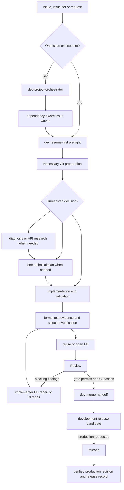

# Develop plugin

Develop delivers dev-ready engineering work through implementation, validation,
pull request, review, CI, merge handoff, and production-release handoff. It
supports one issue, dependency-aware issue sets, focused diagnosis and repair,
and explicit cross-PR integration.

## Main entrypoints

- [`dev`](skills/dev/SKILL.md) owns the complete lifecycle for one dev-ready
  issue and routes sub-issue sets or projects to the project controller. It is
  the common issue-development entry and supports fast, standard, and strict
  modes (standard blocks P0/P1; strict blocks P0/P1/P2).
- [`dev-project-orchestrator`](skills/dev-project-orchestrator/SKILL.md) owns
  engineering waves, barriers, and aggregation for a ready issue set.
- [`dev-planner`](skills/dev-planner/SKILL.md) resolves technical choices and
  sequencing in one plan, with conditional domain and refactor guidance.
- [`dev-implementer`](skills/dev-implementer/SKILL.md) owns scoped implementation
  and PR repair, with conditional TDD and PR-comment/conflict guidance.
- [`dev-debugger`](skills/dev-debugger/SKILL.md),
  [`dev-spike`](skills/dev-spike/SKILL.md), and
  [`dev-api-research`](skills/dev-api-research/SKILL.md) provide bounded
  investigation paths.
- [`dev-integration-manager`](skills/dev-integration-manager/SKILL.md) integrates
  an explicit PR set using the supplied ordering strategy.

Repository setup, deployment-skill authoring, and production releases are
provided by the separately installed DevOps plugin. Install it when using those
entrypoints or following a production-release handoff.

## Workflow



Develop needs no Product plugin, router or paid credential: `$dev` audits
readiness itself and asks the requester for any missing product decision.
When Product is installed, its Skills run only on explicit request and are
advisory. Technical review is delegated to the independently installable Review
plugin. Platform-specific Apple work can use the Apple Development plugin
inside the same Dev lifecycle.

Install with `codex plugin add develop@jay1803-ship-skills`.
Behavioral gates and mutation authority live in the individual Skills and their
references, not in this overview.

## Controller And Worker Ownership

Project orchestration and issue delivery use two persistent management layers.
The orchestrator schedules and monitors workers; it does not implement or
technically review. Issue workers merge by default; an explicit user/repository
assignment changes only that action's executor. Each `$dev` issue worker implements inline by
default, delegating to a bounded implementer only for degraded context, parallel
slices or isolation; it coordinates independent Review sub-agents, owns PR/CI
and authorized merge, and returns closeout evidence. A bounded agent is not a third persistent layer.
See the [canonical role boundary](skills/dev/references/execution-ownership.md#controller-issue-worker-and-bounded-agents).

Both roles default to unattended standard execution. Material delivery decisions
are recorded on tickets. Newly discovered out-of-scope work shares one follow-up
parent: nonblockers stay deferred, while necessary blockers enter the current
delivery through the existing decision owners. See the
[canonical decision and discovery rule](skills/dev/references/execution-ownership.md#autonomous-decisions-and-discovered-work).

## Agent Routing Profiles

`agent-routing` routes offline: the calling agent decides the task semantics and
`scripts/route_agent.py` applies the floors and the model table in
`scripts/models.json`. It needs no credential or network access.

Provider-neutral role definitions live in `skills/agent-routing/assets/roles/`;
the generated `assets/codex-agents/` and `assets/claude-agents/` profiles omit
model and effort so a role never pins its binding. From the Skill directory,
regenerate and check them after changing a role, then copy them into a client:

```bash
./scripts/render-agent-profiles.py --write
./scripts/render-agent-profiles.py --check
./scripts/link-codex-agents.sh --apply    # Codex, $CODEX_HOME
./scripts/link-claude-agents.sh --apply   # Claude Code, ~/.claude/agents/
```

Both link scripts accept `--check` and `--target-dir PATH`. Restart a Claude Code
session after its `agents/` directory is created for the first time.

The optional [DeepSeek V4.1 Flash profile](skills/agent-routing/assets/codex-profiles/deepseekv41flash.config.toml)
uses OpenRouter without changing Codex's default model or automatic routing.
Install it with `./scripts/install-codex-openrouter-profile.sh --apply` (or
`--check`, `--target-dir PATH`) and select it with
`codex --profile deepseekv41flash`. Put one `API_KEY=...` assignment in
`~/.config/openrouter/.env.local`, readable only by its owner; the profile's auth
command parses that assignment at request time and never executes the file. It
is a manual CLI binding: it does not reach Codex desktop thread creation or
change the controller and reviewer floors.

## Consolidated Skill Surface

Develop contains 16 independent Skills. Keep one suitable implementation owner
for scoped coding, test/failure classification, and repair when context, tools,
permissions, and capability match. Phase responsibilities and controller
acceptance remain explicit; a new phase name alone does not require a new agent.
Delegate for independent judgment, isolation, useful parallelism, capability,
or an explicit request. Independent technical Review and any explicitly
independent verification remain separate.

Repository discovery happens inside the current owner when a fact is missing.
Technical planning produces one decision-oriented artifact; domain/refactor
analysis expands that plan only when needed. Testing may reuse inspectable,
matching evidence and reruns missing, invalidated, or explicitly fresh checks.

## Invocation Migration

Update saved prompts and automation callers when adopting this consolidation:

| Retired entry | Current destination |
| --- | --- |
| `dev-repo-context` | Current planning/implementation owner gathers bounded repository facts |
| `dev-architect` | `dev-planner` technical approach, with slices only when needed |
| `dev-refactor-architect` | `dev-planner` with `references/refactor.md` |
| `dev-domain-modeling` | `dev-planner` with `references/domain-modeling.md` |
| `dev-tdd` | `dev-implementer` with `references/tdd.md` |
| `dev-fix` | `dev-implementer` with `references/pr-repair.md`; existing PR and Review Run preserved |
| `dev-release-handoff` | `dev-merge-handoff` for an issue integration PR, or DevOps `release` for production promotion |

Retired Skill directories and compatibility routers are not distributed.
Historical receipts remain evidence, not permission to replay a retired entry
or reset a repair counter. Plugin publication and consumer installation are
separate from this source change; consumers using old names must update their
calls when installing the new package.

## Discovery evaluation

The cases in `evals/behavior/fixtures/mx117-develop-trace.json` stage all 16
current Develop entrypoints. They check one-issue delivery, defect diagnosis,
project issue waves, PR CI repair, and two nearby requests owned outside
Develop.

```bash
npm run eval:trace -- \
  --case mx117-develop-trace/explicit-single-issue \
  --case mx117-develop-trace/implicit-defect-diagnosis \
  --case mx117-develop-trace/contextual-project-waves \
  --case mx117-develop-trace/implicit-red-pr-checks \
  --case mx117-develop-trace/negative-product-outcomes \
  --case mx117-develop-trace/negative-independent-pr-review \
  --run-dir .eval-runs/develop-discovery-1
```

This opt-in run uses disposable read-only workspaces and retains Codex JSONL
for the checker described in `evals/behavior/contract.md`. It tests Skill
selection only; it does not execute issue delivery or validate the later
implementation, PR, Review, or merge phases.
