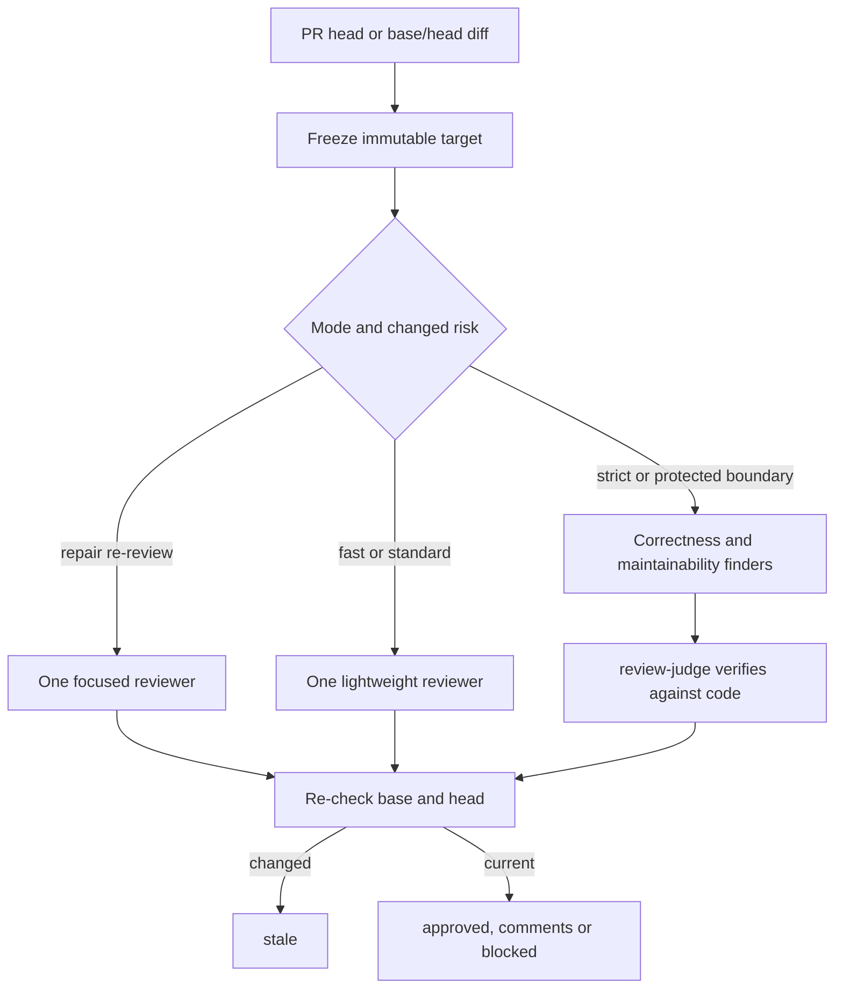

# Review plugin

Review runs one stateless, independent technical review of an immutable
pull-request head or explicit base/head diff. Mode and changed risk select one
lightweight reviewer, one focused re-reviewer, or two finders plus a Judge that
verifies every candidate against the code. Callers own the review loop.

## Main entrypoints

- [`review`](skills/review/SKILL.md) freezes the target, selects depth and
  returns one result.
- [`review-spec`](skills/review-spec/SKILL.md),
  [`review-correctness`](skills/review-correctness/SKILL.md), and
  [`review-code-quality`](skills/review-code-quality/SKILL.md) own the finding
  contracts and can run on their own.
- [`review-judge`](skills/review-judge/SKILL.md) verifies and combines the
  findings of a full review.
- [`review-pr`](skills/review-pr/SKILL.md) provides focused production-code
  structural review and posts inline comments only when explicitly requested.

## Workflow

Review does not merge, repair, count rounds, or change the frozen target.
Install it with `codex plugin add review@jay1803-ship-skills`. Severity and result
rules live in the corresponding Skills and references.
